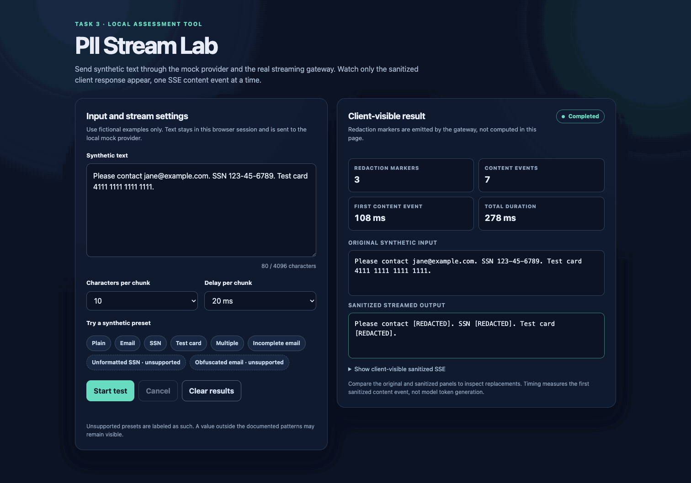

# Solution Architect Assessment

Four independent Python tasks demonstrate MCP tooling, gateway authorization, inspection of streamed output, and token-aware model routing. Each task is independently runnable and documented. These are assessment implementations with local mock data and services, not production deployments.

| Task | Architecture | Details |
| --- | --- | --- |
| 1 — MCP server | A Python stdio MCP server exposes fictional customer lookup and simulated refund tools with validated inputs. | [Task 1 README](task1/README.md) |
| 2 — MCP security gateway | A FastAPI HTTP/JSON-RPC gateway authenticates callers, applies tool permissions, and forwards authorized requests to a mock downstream server. | [Task 2 README](task2/README.md) |
| 3 — Streaming PII guardrail | A mock provider streams SSE through a gateway that buffers possible sensitive text and emits rebuilt, sanitized events. | [Task 3 README](task3/README.md) |
| 4 — Token-aware router | A gateway reserves tenant token capacity in SQLite, calls a primary mock provider, and falls back on 429 or timeout. | [Task 4 README](task4/README.md) |

## Install and test

Use Python 3.11 or newer from the repository root:

```sh
python3.11 -m venv .venv
.venv/bin/python -m pip install -e '.[test]'
.venv/bin/python -m pytest -q
```

## Task 3 PII Stream Lab

The optional [interactive playground](task3/README.md#interactive-manual-testing) lets reviewers send synthetic text through the same provider, streaming gateway, and redactor used by the API. It shows the original input beside the progressive client-visible output and streaming measurements. It runs locally or in a reviewer's own Codespace; GitHub does not host a live instance. The route is disabled by default.



